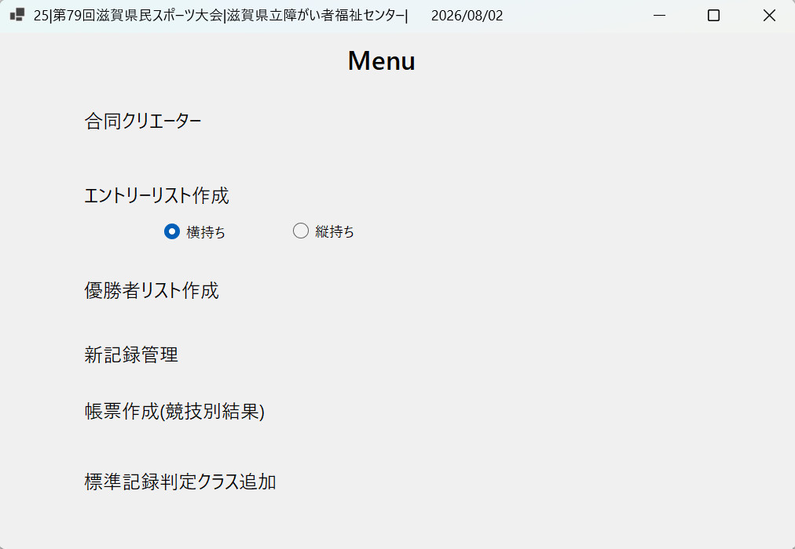

# SeikoHelper
セイコーリザルトシステムの補完ツール。

以下のことができます。

## 合同クリエイター
合同レースができるようにレーンを移動する。また、セイコーリザルトで使う合同テーブルを作成する。

## エントリーリスト作成 
エントリーされている個人、チームの一覧を作成する。登録番号(リレーオーダー表記入時に必要)、氏名、性別、所属、クラス名称、距離、種目、競技番号-組-レーン番号、出場種目名 がexcelで出力される。SEIKO リザルトシステムでも同様のものが出力されるがとても分かりにくい。こちらだとexcelのfilterの機能なども使えるのでとても便利。

## 一位リスト作成
競技終了後優勝者のリストを作成する。事前にSQL ServerにView の登録が必要。また、 一位リスト作成にはtemplateのxlsx が必要。
template には 次の名前を定義しておく必要がある。
  (性別)(クラス番号)_(距離コード)_(種目コード)Time　=> この名前のcellにその性別、クラス番号、距離、種目のtimeが入る。

  (性別)(クラス番号)_(距離コード)_(種目コード)Name

  (性別)(クラス番号)_(距離コード)_(種目コード)Team

  (性別)(クラス番号)_(距離コード)_(種目コード)GR

　例えば、 男子1_3_1Time という具合。　
　
　template file 作成にはtemplateTool.bas を使うと自動でできる。

## 大会新記録抽出
発生新記録の excel 作成。
大会前の大会記録excelを読み込み大会後の大会記録excelを作成する。
Server に入っている大会記録とexcelの比較。
大会記録excelをServerにコピー。
大会終了後、大会記録を更新し 新記録.txtを出力。

大会記録のexcelには一位リストと同様にセルに名前を定義しておく必要がある。

# How to compile
まずはtop directory で
.\build.ps1 
cd CreateEntryList
.\build.ps1

実行ファイルは
bin\SeikoHelper.exe
CreateEntryList\bin\CreateEntryList.exe 
